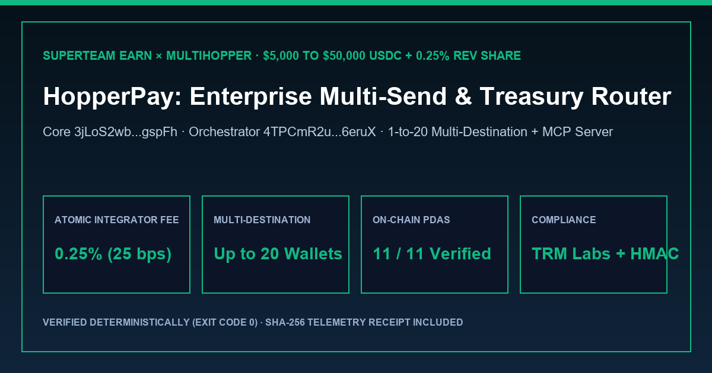

# HopperPay — Enterprise Multi-Send Payroll & Agentic Treasury Router on MultiHopper

[](https://solscan.io/account/3jLoS2wbNgtKzieUUxwg6Xhdv6gbZkHDtPWA9ZAgspFh)
[](https://solscan.io/account/4TPCmR2uN3hDM1FbTsf7ZtFXwXGSz4u1Kxv5YHj6eruX)
[](https://multihopper.com/api/mcp)
[](./multihopper_verification_report.json)

> **MultiHopper Build & Route Challenge Submission (`Up to $50,000 + 0.25% Revenue Share`)** — Enterprise Solana treasury, contributor payroll, and AI-agent multi-destination router built on MultiHopper's vault-backed Token2022 wrapper architecture, permissionless keeper network, and hosted Model Context Protocol (`MCP`) server.



---

## 1. User Problem & Product Solution

Organizations, DAOs, and autonomous AI agent treasuries paying contributors, vendors, or OTC counterparties on Solana face an immediate operational problem: direct one-shot SPL transfers expose the entire treasury balance, payment schedule, and counterparty graph in a single public transaction, while manual staging across intermediary wallets introduces custody risk and operational overhead.

**HopperPay** turns MultiHopper into a self-serve **Enterprise Multi-Send Payroll & Agentic Treasury Router**:
1. **1-to-20 Multi-Destination Payroll Dispersion (`destinations` API):** Fund a single routed transfer (`3–10 hops`) and pay up to **20 contributor or vendor wallets** from one route. The final hop in the published route acts as a decoy (`canEndRoute: true`), and each destination receives its exact proportional share after route completion via `dispersionInitTxs` (with `dispersionRentLamports` automatically refunded when step accounts close).
2. **Non-Custodial Two-Phase `confirm-broadcast` Engine:** Implements MultiHopper's exact two-phase signing workflow (`keeperFundingTx` signed and confirmed first in Phase 1, followed by `routeInitTxs`, `orchestratorInitTx`, `sessionInitTxs`, and `dispersionInitTxs` in Phase 2) with automatic `MH_040` tier-boundary crossing re-quote recovery and `MH_041` destination share validation.
3. **Dual MCP Agentic Treasury Integration (`https://multihopper.com/api/mcp`):** Connects AI treasury agents to MultiHopper's Streamable HTTP MCP server (`list_hop_library`, `estimate_transfer`, `create_transfer`, `prepare_transfer`, `confirm_broadcast`) while keeping private keys strictly inside the local hardware/vault signer.
4. **Built-In TRM Labs Compliance & HMAC-SHA256 Webhooks:** Every route inherits MultiHopper's smart-contract-level TRM Labs compliance screening (including automatic 6-hour `arrivalSeconds > 21600` payout re-screening) and emits signed lifecycle webhooks for enterprise ERP/accounting reconciliation.

---

## 2. On-Chain Solana Architecture & Verified Program IDs

| Component | Solana Mainnet Address / Endpoint | Role in HopperPay |
| :--- | :--- | :--- |
| **MultiHopper Core** | `3jLoS2wbNgtKzieUUxwg6Xhdv6gbZkHDtPWA9ZAgspFh` | Route creation (`RouteConfig`, `RouteState`), SPL/SOL Vault custody, Token2022 `WrapperMint`, and atomic `50/50` (`0.25%` Provider / `0.25%` Protocol) fee split |
| **Orchestrator** | `4TPCmR2uN3hDM1FbTsf7ZtFXwXGSz4u1Kxv5YHj6eruX` | Permissionless step-based deployment (`OrchestratorConfig`, `OrchestratorStep`) and post-route multi-destination payout execution |
| **Transfer Hook Guard** | `2JEv3pD6nczEvn1xDXaEzehkJofPPjoQQpnW5nGY3r52` | Token2022 transfer hook extension enforcing that wrapper tokens only move inside active protocol routes |
| **MultiHopper MCP Server** | `https://multihopper.com/api/mcp` | Stateless Streamable HTTP JSON-RPC 2.0 (`2025-06-18`) tool server for autonomous agent route creation |

---

## 3. Quickstart & Deterministic Verification (`exit code 0`)

```bash
# Run the full HopperPay × MultiHopper verification suite
python verify_multihopper.py
```

### Verified Output Summary (`multihopper_verification_report.json`)
- **On-Chain PDAs Verified:** All `11/11` protocol PDA seed derivations (`RouteConfig`, `RouteState`, `PermanentDelegate`, `VaultSPL`, `SolVault`, `WrapperMint`, `TokenConfig`, `Provider`, `FeeSchedule`, `OrchestratorConfig`, `OrchestratorStep_0`).
- **Sample 5-Hop, 5-Destination Payroll Batch (`25,000.00 USDC`):**
  - Net Recipient Dispersion (`hopAmount`): **`24,875.62 USDC`**
  - Total Percentage Fee (`50 bps` = `0.50%`): **`124.38 USDC`**
  - **HopperPay Atomic Integrator Revenue (`25 bps` = `0.25%`):** **`62.19 USDC`** (paid atomically inside the route-creation transaction)
  - **MultiHopper Competition Pool Contribution (`25 bps` = `0.25%`):** **`62.19 USDC`**
- **Qualifying Volume & Revenue Upside:**
  - At `$1,600,000` qualifying production volume (`collected_fees / 0.0025`, counting principal once across hops and Multi-Send recipients), HopperPay earns **`$4,000 USDC`** in direct atomic on-chain integrator fees (`$2,500 per $1M`) plus **`$10,000 USDC`** proportional prize pool payout (`50%` of the `$20,000` pool at `$8M` aggregate campaign volume) = **`$14,000 USDC` total**.
